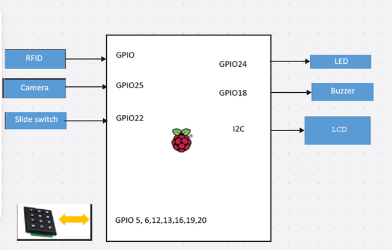
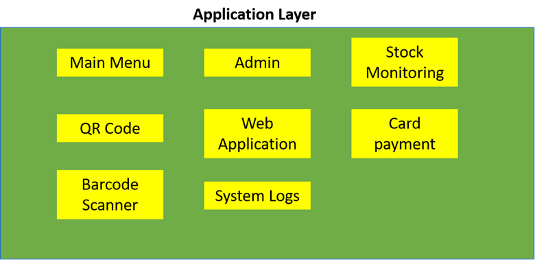
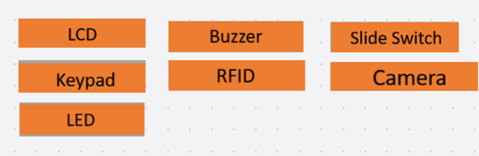
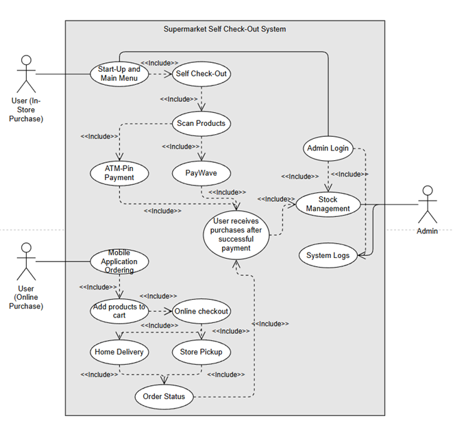
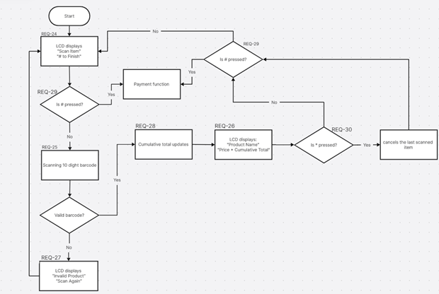
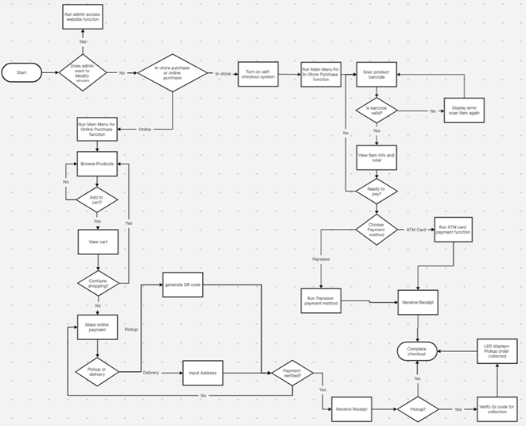

# Group 3 AIoT DevOps Mini Project: Supermarket Self-Checkout System 

## 1. Project Overview
The **Supermarket Self-Checkout System** is an automated checkout solution designed for SPmart Supermarket to reduce customer waiting time during payment.  

The system supports both **in-store self-checkout** and **online purchases**, providing a seamless and efficient shopping experience.

The system has a frontend application (web application) and a Raspberry Pi integrated in-store self-checkout for purchasing and receiving products 

Customers can:
- Scan products and pay independently in-store
- Purchase items online via a website
- Choose between **store pickup** or **home delivery**
- Pay using multiple payment modes in both in-store and online

---

## 2. Objectives
- Reduce checkout queue time
- Improve customer convenience
- Support multiple purchasing methods (online & in-store)
- Provide secure and flexible payment options
- Maintain accurate and centralized product data

---

## 3. System Scope
### In Scope
- Barcode scanning using camera
- Product lookup from central database
- Real-time display of item details and total cost
- ATM PIN and RFID (PayWave) payments
- Online ordering with QR code generation
- Store pickup and home delivery options

### Out of Scope
- Inventory supplier management
- Employee payroll systems
- External banking systems (assumed to exist)

---

## 4. System Requirements

### 4.1 Functional Requirements

#### Admin Access for Staff
- The system shall provide a secure admin login page for supermarket staff
- Admins must authenticate using a username and password
- Only authenticated admins are allowed access to admin-only features
- Unauthorized users shall be denied access to admin pages

To access the admin system, enter the link in a browser: 

http://<Raspberry-Pi-IP>
e.g: http://192.168.0.100 (Admin system and raspberrypi must be in the same wifi to be able to connect) 
#### Product Management (CRUD)
- The system shall allow admins to **create new products** in the central database
  - Required product attributes: 
   - Product Name
   - Price
   - Stock Quantity 
   - Product Image
- The system shall allow admins to view (read) all existing products
- The system shall allow admins to update product information, including:
  - Price
  - Stock Quantity
- The system shall allow admins to delete products
  - Deletion shall be restricted if the product is linked to an active transaction

#### System Integration
- Any changes made by admins shall be **reflected immediately** across:
  - In-store self-checkout system
  - Online web application
-The system shall ensure price and stock consistency across all platforms 
  
#### In-Store Purchases
- Each product has a **10-digit unique barcode**
- Camera scans product barcode
- System retrieves product details from database
- LCD displays:
  - Product name
  - Product price
  - Cumulative total
- Supports multiple item scans per transaction

#### Online Purchases
- Customers can purchase via:
  - Web Application
- Customers can choose:
  - Store pickup
  - Home delivery (additional $4.00 fee)
- #### Store pickup
  - QR code generated after successful online payment
  - QR code is used for item collection at supermarket
- #### Home delivery 
  - Customer required to input their address 
  - Goods will be sent to their inputted address

#### Payment Modes
- ATM payment via numeric keypad (PIN-based)
- PayWave payment via RFID card reader

---

### 4.2 Non-Functional Requirements
- Fast response time (< 2 seconds per scan)
- High availability during operating hours
- Secure handling of payment and customer data
- User-friendly interface
- Scalable for future features (e.g. loyalty points)

---

## 5. System Architecture

### 5.1 High-Level Architecture
The system follows a **client-server architecture** with centralized data management.

---

### 5.2 Software Components

- **Frontend**
  - In-store LCD UI
  - Web application
  - Mobile application
- **Backend**
  - Product management
  - Transaction handling
  - Payment processing
  - QR code generation
- **Database**
  - Product details
  - Prices
  - Orders
  - Transactions

---

## 6. UML Diagrams

### 6.1 Use Case Diagram (Description)
**Actors**
- User (In-Store Purchase)
- User (Online Purchase)
- Admin (Supermarket Staff)

**Main Use Cases**
- Scan product
- View total price
- Make payment
- Add products to cart
- Online Checkout
- Home Delivery 
- Store Pickup

---

### 6.2 Class Diagram (Description)

**Main Classes**
- `products`
  - product_id
  - barcode
  - name
  - price
  - stock
  - image 
  - created_at
  - updated_at
- `transactions`
  - transaction_id
  - total
  - created_at
  - user_id
- `transaction_items`
  - id
  - transaction_id
  - product_id 
  - quantity 
  - price_at_purchase 
- `users`
  - user_id
  - username
  - password
  - created_at
  - address

---

### 6.3 Flow Chart (In-Store Purchase)

---

## 7. System Workflow

### In-Store Checkout
1. Customer scans product barcode
2. System retrieves product details
3. LCD displays product and total price
4. Customer selects payment method
5. Payment is processed
6. Receipt is generated

### Online Purchase
1. Customer browses products online
2. Items added to cart
3. Payment completed
4. QR code generated
5. Customer collects items or receives delivery

---

## 8. Technologies Used (Proposed)
- Frontend: HTML, CSS, JavaScript
- Backend: Python (Flask) / Node.js
- Database: MySQL
- Hardware:
  - Camera for barcode scanning
  - LCD display
  - Numeric keypad
  - RFID card reader

---

## 9. Usage
- Launch in-store system for self-checkout
- Access web/mobile app for online purchases
- Follow on-screen instructions to complete checkout
- Present QR code for item collection if applicable

---

## 10. Future Enhancements
- Loyalty reward system
- Mobile wallet integration
- AI-based product recognition
- Receipt-less checkout
- Multi-language support

